# TriAevum — Echoes of Time & Moonfall Curse

<p align="center">
  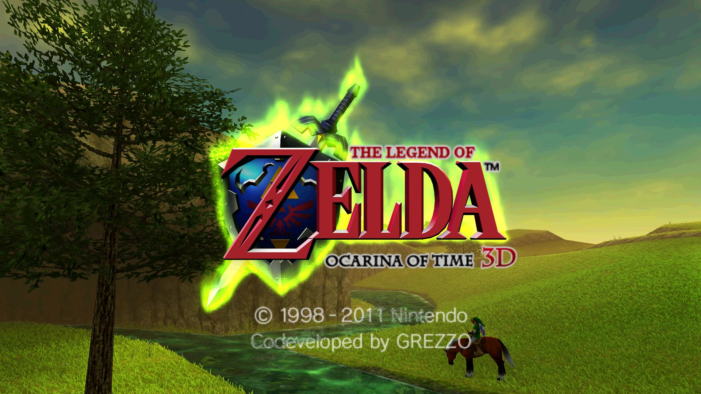
</p>

TriAevum is the engine and project behind two native PC recompilations:
**Echoes of Time**, bringing *The Legend of Zelda: Ocarina of Time 3D* to PC,
and **Moonfall Curse**, bringing *The Legend of Zelda: Majora's Mask 3D* to
the same engine. They share a modern NRI/Vulkan renderer, with lighting,
shadows and customizable graphics, and each has its own single-screen
interface, package and Forge.

One game was apparently not enough to keep me occupied.

## Two games

| Game | Current release | Bring your own dump |
| --- | --- | --- |
| **Echoes of Time** — Ocarina of Time 3D on PC | [v0.8.0-beta.2](https://github.com/coccofresco/TriAevum/releases/tag/v0.8.0-beta.2), a beta | Your own decrypted **Ocarina of Time 3D** dump. EUR and USA, original or Rev 1, are supported inputs; Japanese, Korean and Taiwanese releases are not supported yet. |
| **Moonfall Curse** — Majora's Mask 3D on PC | [v0.5.0-alpha.1](https://github.com/coccofresco/TriAevum/releases/tag/moonfall-curse-v0.5.0-alpha.1), the **first alpha** | Your own decrypted **EUROPEAN Majora's Mask 3D** dump, **CTR-P-AJRP**. Other regions are not supported yet. |

Download the package for the game you want from its release page:

| Platform | Echoes of Time | Moonfall Curse |
| --- | --- | --- |
| Windows x64 | `TriAevum-v0.8.0-beta.2-Windows-x64.zip` | `Moonfall_Curse-v0.5.0-alpha.1-Windows-x64.zip` |
| Linux x86-64 AppImage | `TriAevum-v0.8.0-beta.2-Linux-x86_64.AppImage` | `Moonfall_Curse-v0.5.0-alpha.1-Linux-x86_64.AppImage` |
| Linux x86-64 Flatpak | `TriAevum-v0.8.0-beta.2-Linux-x86_64.flatpak` | `Moonfall_Curse-v0.5.0-alpha.1-Linux-x86_64.flatpak` |

Both are pre-releases. Back up your saves and read the release notes before
assuming something is a feature. No ROMs, game data or game assets are
distributed; you supply your own dump.

## Credit Where It Belongs

Before the shaders, settings and excessive grass: **Echoes of Time would not exist in
its current form without [TopScreen, now SingleScreen](https://gamebanana.com/mods/695893),
developed by rlgcarrot**. Its single-screen experience is reimplemented here for
this runtime, but the vision, care and tremendous work behind it deserve a
special thank-you. Please consider [buying rlgcarrot a coffee](https://ko-fi.com/rlgcarrot)
to support that fantastic work.

The Echoes of Time HD interface comes from **[OoT3D Vanilla UI/HUD](https://gamebanana.com/mods/701929)**
by **chubbycubby**, which Forge downloads for your game's language with your
consent, and the file selection follows the single-screen design of
**[Ocarina Reframed](https://github.com/OTPR26/OOT3DHud)** by **OTPR26**.

The ambient occlusion that makes the grass look like it belongs to the ground
is **MXAO** from **[iMMERSE](https://github.com/martymcmodding/iMMERSE)** by
**Pascal Gilcher** ([Marty's Mods](https://martysmods.com)), integrated and
adapted with his explicit permission. Thank you for lending TriAevum a piece
of work that took years to get this good.

Just as essential are **Azahar, Ship of Harkinian, libultraship, NVIDIA NRI**,
and the SDL controller-mapping community. And, of course, **Nintendo and
Grezzo**, who created the original games. [Full credits and licenses](THIRD_PARTY_NOTICES.md).

Echoes of Time's Forge can also apply an optional mod on your machine:
**[Vanilla+ - Link Remodel And HD Item Models](https://gamebanana.com/mods/705890)**
by **HugAMuffin** (testing by Fado, M-1 and seiunsky_1084; tooling by Jameriquiah).
TriAevum does not distribute it: Forge downloads the author's original archive
when you turn it on ([details](docs/TRIAEVUM_MOD_VANILLA_PLUS_LINK.md)).

**Separately licensed material.** These three parts are not covered by
TriAevum's GPL and keep their authors' terms:

- **iMMERSE / MXAO** (Pascal Gilcher): "All rights reserved". The module is
  built as its own library, shipped beside the runtime, and TriAevum uses it
  under a permission granted to this project only. That permission does not
  pass to forks, recipients or other projects; redistribute TriAevum without
  the module unless the author has given you his own. See
  [LICENSE_SCOPE.md](LICENSE_SCOPE.md#exception-the-immerse-module) and the
  module's `LICENSE-iMMERSE.txt`.
- **OoT3D Vanilla UI/HUD** (chubbycubby): [CC BY-NC-ND 4.0](https://creativecommons.org/licenses/by-nc-nd/4.0/).
  Packages contain none of its files; Forge downloads the author's original
  archive from GameBanana on your request and keeps it in your private data
  folder. See [LICENSES/OoT3D-Vanilla-UI-HUD.md](LICENSES/OoT3D-Vanilla-UI-HUD.md).
- **Vanilla+ - Link Remodel And HD Item Models** (HugAMuffin): [CC BY-NC-ND 4.0](https://creativecommons.org/licenses/by-nc-nd/4.0/).
  Same arrangement: downloaded from GameBanana only when you turn it on, never
  redistributed by TriAevum. See [LICENSES/Vanilla-Plus-Link-Remodel.md](LICENSES/Vanilla-Plus-Link-Remodel.md).

Moonfall Curse's additional credits and licences are listed below.

## About

Echoes of Time is an AOT recomp in the same general spirit as the Xbox 360 recomp
projects. Moonfall Curse is the second game on that engine. I just ended up
spending most of my time on the renderer instead of, you know, actually
playing the games. The goal is to push the visuals further without completely
losing the original look.

**Development of this project is entirely AI-assisted, under human direction.**
That describes the TriAevum-specific work, not the mature donor projects and
libraries it builds on: Azahar, Ship of Harkinian, NRI and others. Aside from
those foundations, you could fairly call this concentrated AI slop.
Apparently, even AI slop can still consume several months of your life.

## Install

The [user guide](docs/USER_GUIDE.md) covers preparation, updating, backups,
uninstalling and Forge's messages. For Moonfall Curse's input requirements
and setup, see [Playing Moonfall Curse](docs/MOONFALL_CURSE.md#playing-moonfall-curse).

Use the package for your game: **each Forge prepares only its own title**.
Both keep the Forge name, `TriAevumForge.exe` on Windows and `TriAevumForge`
on Linux.

You need Windows x64 or Linux x86-64, a Vulkan-capable GPU with current
drivers, and your own supported decrypted dump. Echoes of Time's Forge
accepts `.3ds` and `.cci`; see its
[ROM compatibility details](docs/TRIAEVUM_CONTENT_FAMILY_IMPORT.md).
Moonfall Curse requires the European CTR-P-AJRP dump. Forge checks the
contents, not just the filename.

### Windows

1. Download your game's **Windows-x64 ZIP**, not GitHub's source-code archive,
   and extract it into its own writable folder.
2. Run `TriAevumForge.exe`, select the matching decrypted dump and prepare
   the game.
   - **Echoes of Time:** select the dump on **Home** and press **Prepare**.
     The HD font is included. The HD HUD and menus
     (chubbycubby's OoT3D Vanilla UI/HUD, in the language your ROM boots in)
     are downloaded unless you turn them off under **Enhancements**.
     If the download fails, select the ZIP from
     [the mod page](https://gamebanana.com/mods/701929) there yourself.
   - **Moonfall Curse:** its mm3d-dekui interface and Project Restoration
     are built in. Forge rebuilds the Restoration layout archives from your
     dump during preparation; they are not separate mods you need to install.
3. Start the game from Forge or directly:
   **`Echoes_of_Time.exe`** or **`Moonfall_Curse.exe`**.

For Echoes of Time, Forge replaces the old `TriAevum.exe`. Point any old
shortcut at `Echoes_of_Time.exe`, or start it from Forge.

Keep the folder path reasonably short: Windows still has a 259-character path
limit, and Forge tells you how many characters to give back instead of letting
Windows find out for you.

### Updating Echoes of Time from beta.1.2

Extract beta.2 into a **new folder**. From that new folder, run:

```powershell
forge\triaevum-forge.exe update --update-target "C:\path\to\your\beta.1.2 folder"
```

Your saves, save states, settings and texture packs are preserved. If the
update cannot finish, Forge rolls the installation back. This was tested on
the published beta.1.2 Windows package, **not on a real user installation**
with its own settings and texture packs. If it rolls back, install beta.2
in a fresh folder, copy your `savedata` over and report Forge's message.

Beta.1.2 could not update itself from a ZIP. Beta.2 adds that support, and
both current games ship signed packages for subsequent updates through Forge.

### Linux and Steam Deck

Choose the AppImage or Flatpak for the game you want. Each contains that
game's Forge.

For an **AppImage**, make the downloaded file executable in your file manager
or use the matching command:

```sh
chmod +x TriAevum-v0.8.0-beta.2-Linux-x86_64.AppImage
chmod +x Moonfall_Curse-v0.5.0-alpha.1-Linux-x86_64.AppImage
```

Open your chosen AppImage and prepare the matching dump in Forge.
For Echoes of Time, `--forge` reopens preparation and
`--appimage-extract-and-run` works on systems without FUSE.

For a **Flatpak**, install the downloaded file for your chosen game:

```sh
flatpak install --user TriAevum-v0.8.0-beta.2-Linux-x86_64.flatpak
flatpak install --user Moonfall_Curse-v0.5.0-alpha.1-Linux-x86_64.flatpak
```

Launch the installed application and prepare its matching dump. The Linux
game executables are **`Echoes_of_Time`** and **`Moonfall_Curse`**; the
packages handle launching them.

On Steam Deck, prepare in Desktop Mode, then add the chosen AppImage as a
non-Steam game. Use Steam Input's Gamepad layout without Proton. This setup
instruction is not a claim of physical Steam Deck or Gaming Mode
qualification: that testing has not been performed for Echoes of Time, and
Moonfall Curse's reported release testing was on Windows 11 and under
Proton, on NVIDIA.

### Data and backups

On Windows, user files live under the installation's `data/` folder,
including `data/savestates` and `data/logs`. Echoes of Time migrates existing
save states on its first start.

For Echoes of Time's AppImage, the data location is
`$XDG_DATA_HOME/TriAevum` (normally `~/.local/share/TriAevum`);
its Flatpak uses `~/.var/app/io.github.coccofresco.TriAevum/`.
For Moonfall Curse, use the data folder shown by its Forge; settings, saves,
logs and caches live there. See the
[user-data reference](docs/TRIAEVUM_USER_DATA.md) for the folder layout.

Echoes of Time's Forge **Data & backups** page backs up saves, save states
and settings into one ZIP and restores them; it also shows the folders.
When an installation is broken, **Home** identifies the problem and offers
**Repair**.

No compiler or SDK is needed. Forge prepares GPU pipelines through the game
during setup. Echoes of Time only needs an Internet connection for its
optional HD interface pack and mods.

## Echoes of Time graphics and controls

- Cel/toon shading and outlines, as a preset you can leave off.
- Ambient occlusion, shadows, water reflections and anti-aliasing, with the
  expensive ones at half resolution so 4K no longer requires an upscaler.
- Anisotropic filtering, set to 4x in the Enhanced preset.
- Real widescreen framing, selectable aspect ratios (16:9, 21:9, original 5:3)
  and configurable field of view.
- **60/90 FPS visual interpolation** of the original 30 Hz game state.
  Game logic and gameplay speed remain unchanged; this is not 60/90 Hz physics.
  Input is sampled late, so Link jumps when you press the button, not shortly
  after.
- Azahar-compatible custom textures and texture dumping, plus the optional
  Vanilla+ Link remodel as a local overlay.
- Reimplemented **SingleScreen** HUD, pause menus, ocarina and Sheikah Stone
  Visions on one screen, and Ocarina Reframed's file selection.
- Configurable gameplay free camera and photo mode, keyboard/mouse and
  controller inputs.
- Named settings profiles, audio and save states.
- Controller rumble on supported pads, and menu button prompts that follow
  your pad.
- Procedural grass. A lot of grass. Possibly too much grass, now within a VRAM
  budget so it stays where you left it.

Press **Esc** (or **R3** on a pad) for the in-game menu: the everyday
settings, navigated with the D-pad or sticks, A to select, B to go back,
LB / RB for the tabs, or with the mouse. The game pauses behind the menu and
continues exactly where it stopped when you close it. Press **F1** for every
setting. **F2** temporarily disables the main added graphics effects, then
restores them without losing your configuration. Most of the presentation is
configurable, so if my artistic decisions offend you personally, you can
probably undo them. Effects can be expensive; adjust them to suit your GPU.

## Moonfall Curse

Moonfall Curse is the 2015 Majora's Mask 3D game, recompiled and running
natively on PC. Its first alpha includes:

- **mm3d-dekui's single-screen interface**, built into the product.
- **Project Restoration**, also built in. Forge rebuilds its layout archives
  containing game material from your own dump; the package carries the recipe.
- **The Echoes of Time renderer**, with native lighting and shadows, the
  **Enhanced** preset and **iMMERSE MXAO** ambient occlusion.
- An HD font, the **Esc / R3** menu and controller glyphs that follow your pad.
  **F1** opens the graphics settings.

### What first alpha means

Automated runs installed and booted the game, then visited about a hundred
scene entrances, the transformations and the boss lairs. That is not a full
playthrough. A complete three-day cycle played by a human with a controller
is still the part I am asking for. Visiting a boss lair and beating its
occupant remain different qualifications.

The release was tested natively on Windows 11 and under Proton, on NVIDIA.
That does not establish AMD or Intel coverage.

Bow and first-person items, the owl-statue save round trip, controller
hot-plugging and several individual rooms passed automated checks but were
**not verified live by hand**. The release notes spell out the remaining gaps.

Some mm3d-dekui options are not ported yet: the gear photo, menu backdrop,
stick controls, ocarina input layout and equip label. The ported options
ship with vanilla defaults.

### Moonfall Curse credits and licences

- **mm3d-dekui**, by **tgacquin and contributors**: **GPL-2.0**.
  Notice: `LICENSES/mm3d-dekui.md`.
- **Project Restoration**, by **leoetlino and contributors**:
  **GPL-2.0-or-later**. Notice: `LICENSES/Project-Restoration.md`.
- **iMMERSE MXAO**, by **Pascal Gilcher**:
  included under its own licence and the project-specific permission described
  above. Notices: `LICENSES/iMMERSE-MXAO.md` and
  `LICENSES/iMMERSE-LICENSE.txt`.
- The **SingleScreen 3.1 HD Latin font**, by **M-1 / rlgcarrot**,
  used with the author's permission. Forge builds the HD message font from it;
  its notice is `LICENSES/SingleScreen-3.0.md`.
- **2Ship2Harkinian, zeldaret/mm and the MM3D decompilation**:
  their documentation guided the work. None of their code or data is shipped;
  see [Moonfall Curse's documentation](docs/MOONFALL_CURSE.md).

These notices are in [LICENSES/](LICENSES/). Project Restoration's notice
also records the upstream layout members whose origin is unclear:
`Hud2.mfl`, `HudItemIconSet.mfl` and `hud_patrs01_action_text.ctxb`.
Those members ship as upstream distributes them; the three layout archives
containing game material are rebuilt from your dump during installation.

Moonfall Curse ships a precompiled title module. Its corresponding source is
in the package's `source/` directory; see the
[source offer](SOURCE_OFFER.md).

## Echoes of Time screenshots

Captured directly from the renderer's framebuffer during beta.1.2 development
on Windows, with the default graphics profile, the HD interface pack and the
toon preset off. The night title screen comes from the released package's own
qualification run.

<table>
  <tr>
    <td width="50%">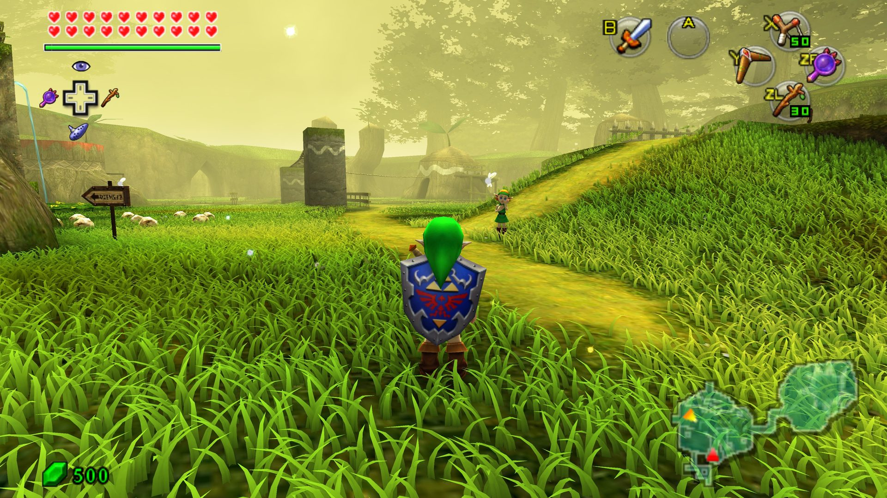</td>
    <td width="50%">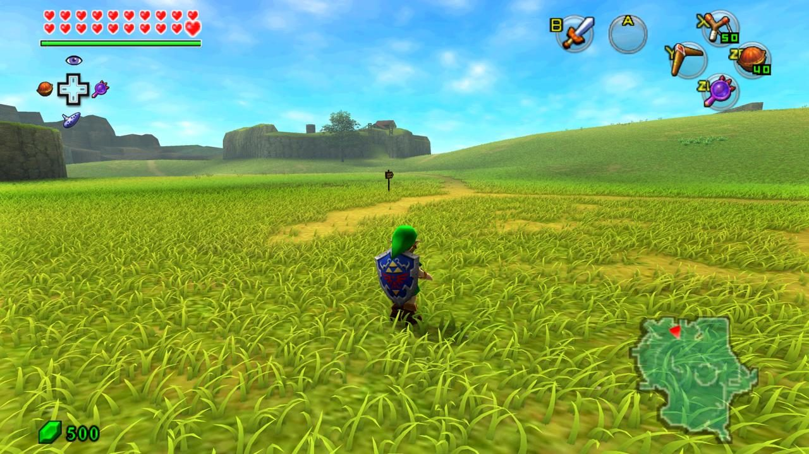</td>
  </tr>
  <tr>
    <td align="center"><sub>Kokiri Forest, grass and ambient occlusion on</sub></td>
    <td align="center"><sub>Hyrule Field, now with grass that stays put</sub></td>
  </tr>
  <tr>
    <td>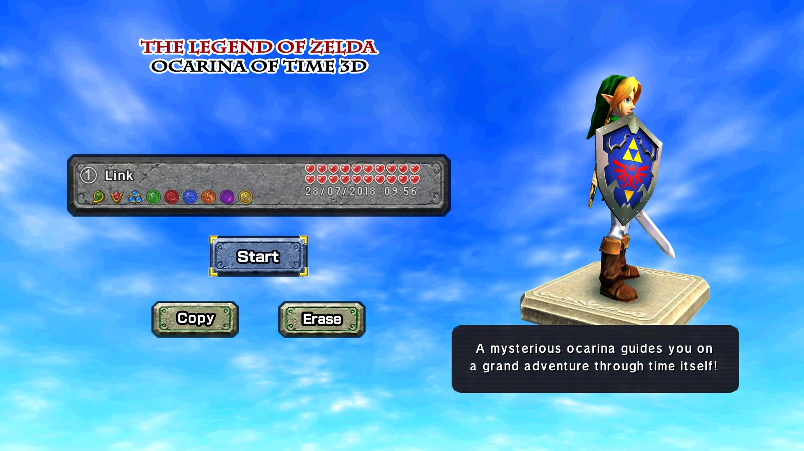</td>
    <td>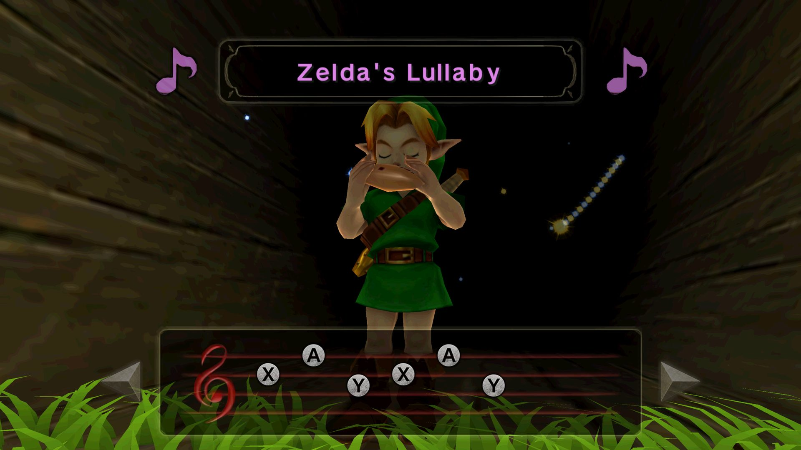</td>
  </tr>
  <tr>
    <td align="center"><sub>File selection in the Ocarina Reframed layout</sub></td>
    <td align="center"><sub>Ocarina with the melody browser on one screen</sub></td>
  </tr>
  <tr>
    <td>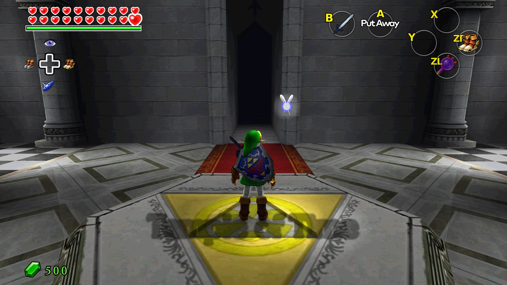</td>
    <td>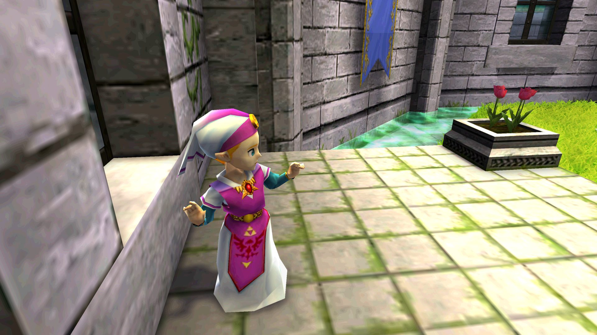</td>
  </tr>
  <tr>
    <td align="center"><sub>Temple of Time</sub></td>
    <td align="center"><sub>The ending credits, which no longer crash</sub></td>
  </tr>
  <tr>
    <td>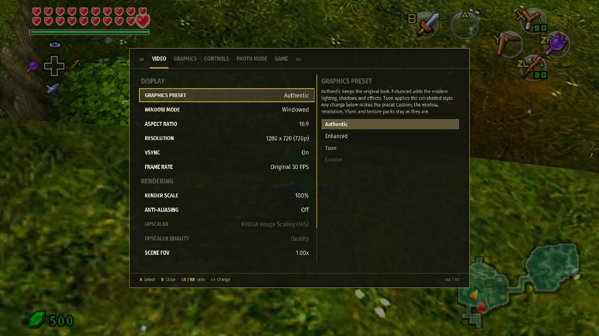</td>
    <td>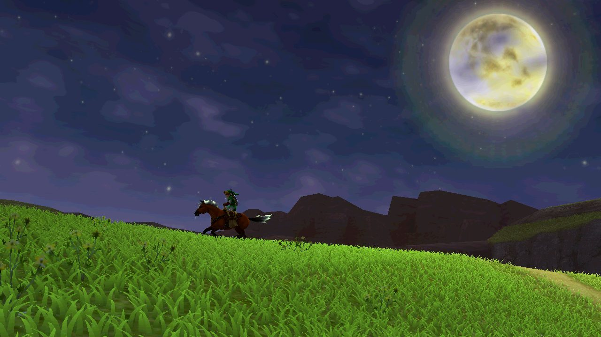</td>
  </tr>
  <tr>
    <td align="center"><sub>Esc / R3 in-game menu; the game pauses behind it</sub></td>
    <td align="center"><sub>Title intro at night, from the released package</sub></td>
  </tr>
</table>

## Moonfall Curse screenshots

Captured from the released alpha.1 Windows package at 1920x1080, with the
Enhanced preset.

<table>
  <tr>
    <td width="50%">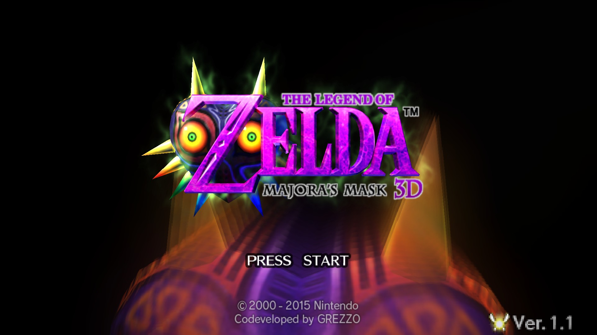</td>
    <td width="50%">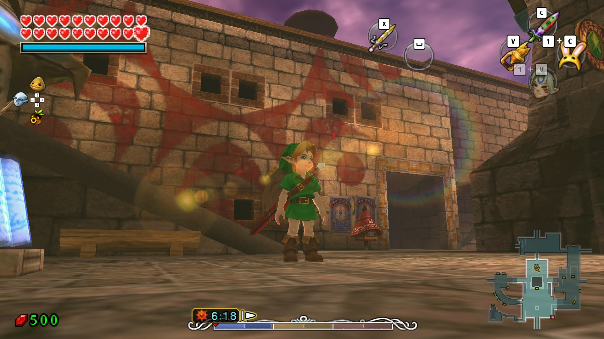</td>
  </tr>
  <tr>
    <td align="center"><sub>Title screen</sub></td>
    <td align="center"><sub>South Clock Town, dawn of the first day</sub></td>
  </tr>
  <tr>
    <td>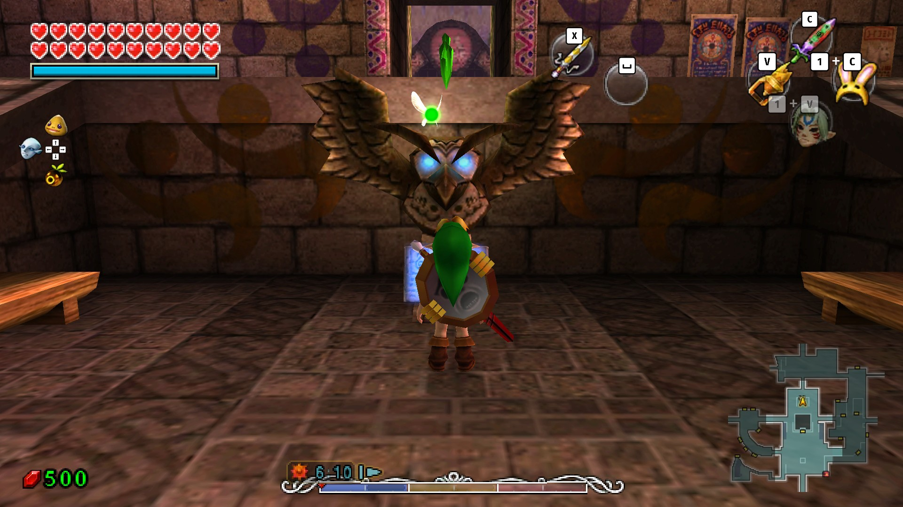</td>
    <td>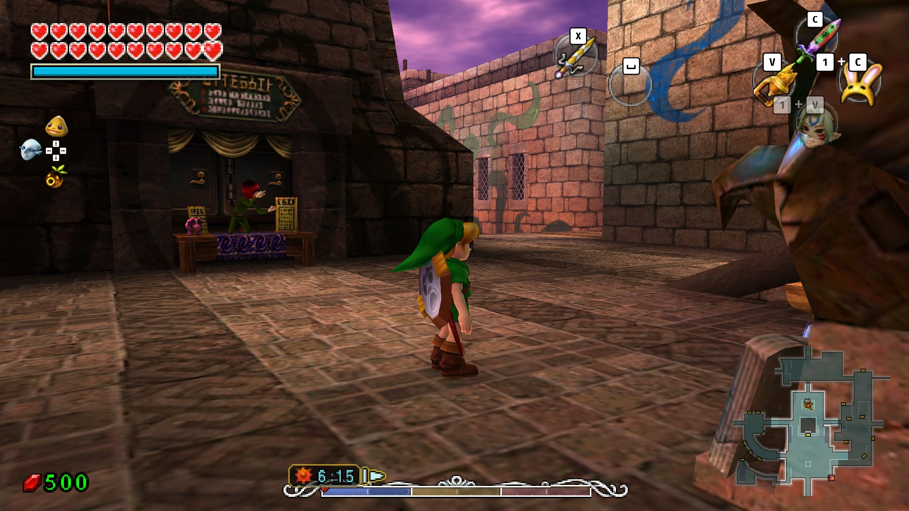</td>
  </tr>
  <tr>
    <td align="center"><sub>The owl statue, with the single-screen HUD</sub></td>
    <td align="center"><sub>Clock Town with native lighting and shadows</sub></td>
  </tr>
  <tr>
    <td>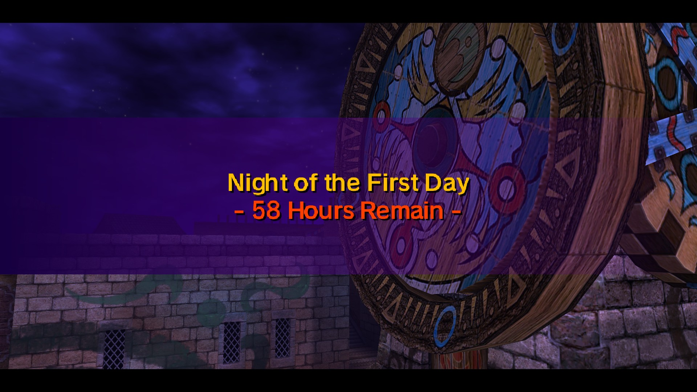</td>
    <td>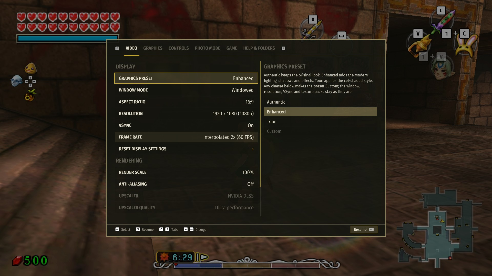</td>
  </tr>
  <tr>
    <td align="center"><sub>58 hours remain. You always have three days</sub></td>
    <td align="center"><sub>Esc / R3 in-game menu; the game pauses behind it</sub></td>
  </tr>
</table>

## Known limits

Both games currently ship for **Windows x64 and Linux x86-64 only**
(AppImage and Flatpak).

Two open issues are shared by both games:

- **[#105](https://github.com/coccofresco/TriAevum/issues/105)**:
  the courtyard crawl hole problem reported in Echoes of Time could not be
  reproduced here. It remains open.
- **[#96](https://github.com/coccofresco/TriAevum/issues/96)**:
  objects can flicker at interpolated 60 FPS with native lighting.
  It is not fixed in either release.

## Testing and contributing

Echoes of Time is an **experimental beta**; Moonfall Curse is a **first
alpha**. Neither is a fully tested port.

For Echoes of Time, gameplay testing covers the early parts of the game on
my side; reporters have since taken it all the way to the credits, which is
how the credits got fixed. The USA adapter has been checked through
installation, the title intro and file selection, not a full playthrough.
Linux packages have been qualified on an AMD (Mesa RADV) desktop, with
earlier betas qualified on NVIDIA's proprietary driver. Beta.2's changed
Windows compiler build was tested on Windows 11 and under Proton, on NVIDIA;
Windows AMD drivers remain untested here. Moonfall Curse's testing coverage
is described above.

I find tweaking shaders considerably more entertaining than finishing Zelda
again, so people willing to actually play through either game are especially
welcome.

Please [report issues](https://github.com/coccofresco/TriAevum/issues) with the
**game name**, version, ROM input/revision, GPU/driver, operating system,
settings and steps to reproduce. Include the console output and game log
from `data/logs` on Windows, or the game's data folder on Linux.
Echoes of Time's log is `oot3d_native_game.log`; Moonfall Curse's is
`TriAevum - Moonfall Curse.log`.

For Echoes of Time, Forge's **Diagnostics** page offers
**Save support bundle...** and shows the log folder. The bundle removes
user names and installation folders.
**Normal in-game save files are particularly useful for problems later in the
game.** Review logs for personal information before sharing; do not upload
ROMs, extracted assets or memory savestates containing game code.

Contributions, experiments and forks taking the renderer in other directions
are welcome. [Community contributors and PR credits](docs/TRIAEVUM_CONTRIBUTIONS.md)
are recorded separately from the original AI-assisted development.

Release notes:
[Echoes of Time beta.2](https://github.com/coccofresco/TriAevum/releases/tag/v0.8.0-beta.2)
and
[Moonfall Curse alpha.1](https://github.com/coccofresco/TriAevum/releases/tag/moonfall-curse-v0.5.0-alpha.1).
[All releases](https://github.com/coccofresco/TriAevum/releases).

## Source and license

Original contributions are licensed under **GPL-3.0-or-later**. Third-party
components retain their own licenses and notices:
[license scope](LICENSE_SCOPE.md) and [third-party notices](THIRD_PARTY_NOTICES.md).
See the [release and build contract](docs/TRIAEVUM_PRECOMPILED_RELEASE.md) for
source availability and developer packaging, and the [source map](docs/TRIAEVUM_SOURCE_MAP.md)
for where the main components live. The
[source offer](SOURCE_OFFER.md) covers corresponding source for the
precompiled title modules.

TriAevum, Echoes of Time and Moonfall Curse are independent fan projects,
not affiliated with or endorsed by Nintendo. No ROMs, game data or game
assets are distributed.

Worst case scenario, at least we got more grass.
